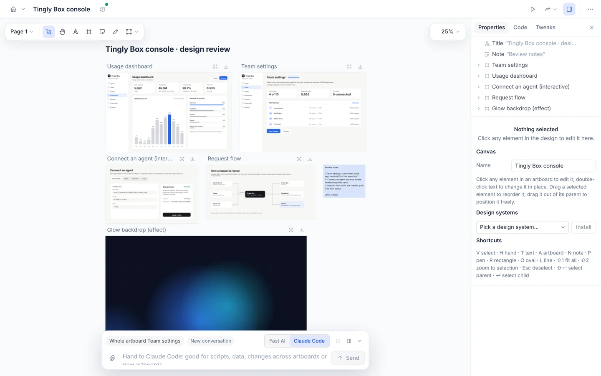
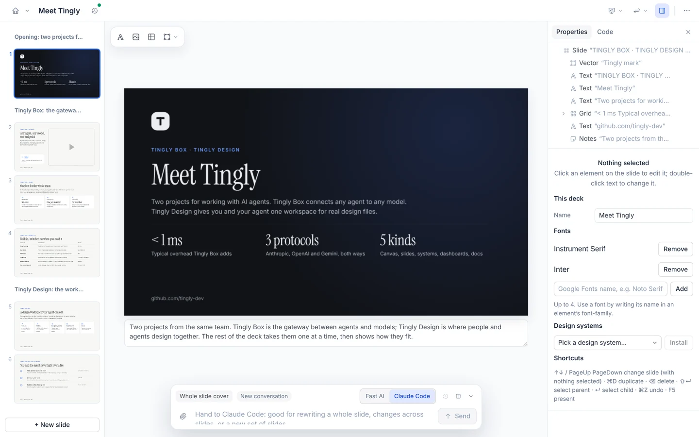
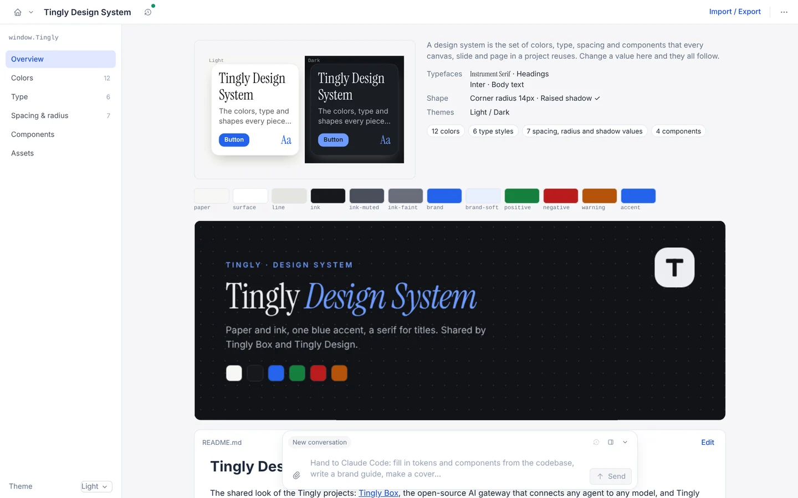
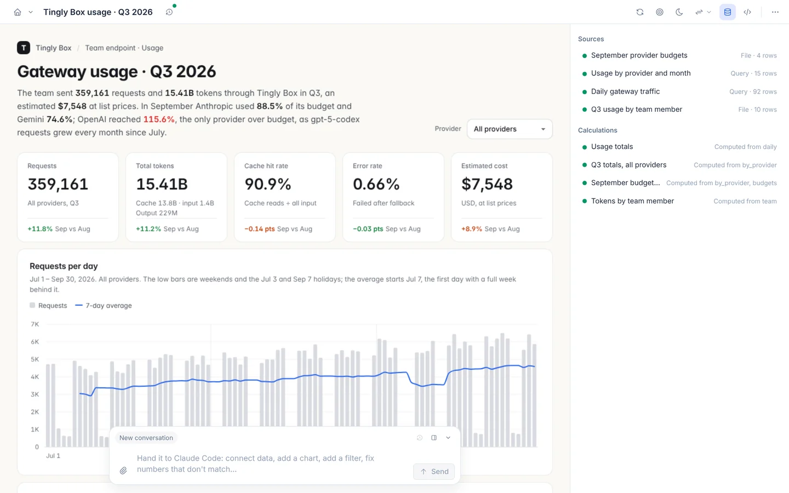
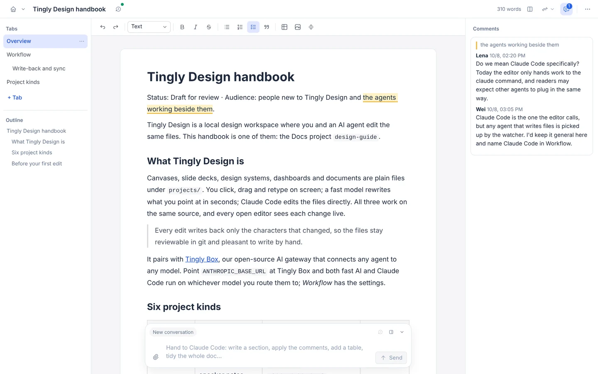
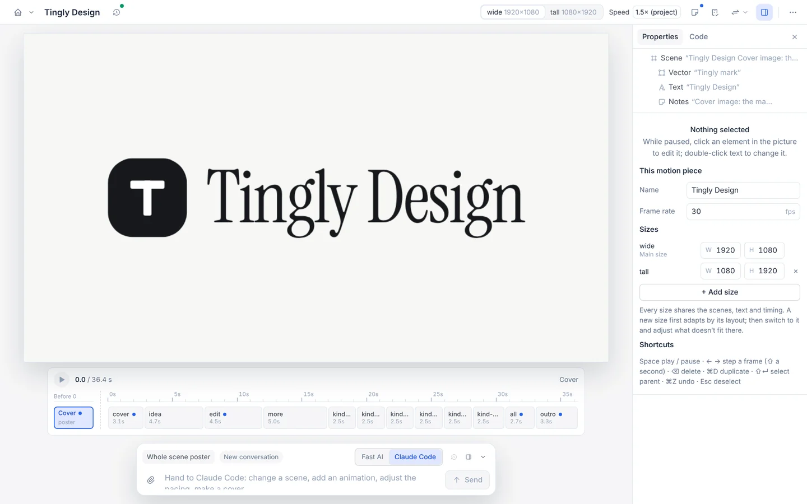

<p align="right"><b>English</b> · <a href="README.zh-CN.md">简体中文</a></p>

<p align="center">
  
</p>

<h3 align="center">An open-source design tool where people and AI edit the same files.</h3>

<p align="center">
  <a href="#quick-start">Quick start</a> ·
  <a href="#six-kinds-one-workspace">Six kinds</a> ·
  <a href="#documentation">Documentation</a> ·
  <a href="LICENSE">Apache-2.0</a>
</p>

<p align="center">
  
</p>

<p align="center"><sub>Made with Tingly Design itself: <a href="projects/tingly-design-motion"><code>projects/tingly-design-motion</code></a>, a motion project, rendered by the app's own exporter.</sub></p>

## One design, three ways to edit it

Canvases, slide decks, design systems, dashboards, documents and motion pieces are plain files under `projects/`. You click, drag and retype on screen; a fast model rewrites what you point at in a few seconds; Claude Code edits the files directly. All three work on the same source, and every edit writes back only the characters that changed, so the files stay reviewable in git and pleasant to write by hand.

| | |
|---|---|
| **Direct manipulation** | Click any text and type, drag to move, resize on the stage. Instant. |
| **Fast AI** | Point at something and say what you want; jQuery statements run as they stream in. Seconds. |
| **Claude Code** | Whole files, several at once, from the prompt bar or a terminal. Minutes. A project keeps one Claude Code conversation, so the next request, from the editor or the command line, carries on where it stopped. |
| **Minimal write-back** | Template holes like `{{price}}`, loops and your own formatting survive every edit. Tick a checkbox or change a colour and the git diff is one line. |
| **Numbers you can check** | Every figure on a dashboard names the cell it comes from; anything that disagrees with its data is reported. |

## Beyond the editor: CLI, skill, MCP

All three need Node 20 or newer, and `claude` (Claude Code) for the AI parts. In this repository, write `pnpm tingly-design` for `npx tingly-design`.

**Install once (optional).** `npm i -g tingly-design` puts two commands on your PATH, `tingly-design` and the short `td`; they are the same program, so every `npx tingly-design …` below is also `td …`. Without installing, `npx tingly-design` fetches it on demand.

**CLI.** Create a project, open it in the editor, ask Claude Code to change it:

```bash
npx tingly-design new slides pitch --title "Q3 pitch"     # create (a path such as ./pitch puts it in your own folder)
npx tingly-design open pitch                              # start the editor and open it in your browser; stays up until Ctrl+C
npx tingly-design prompt pitch "Tighten the title slide"  # in a second terminal: Claude Code edits, the open editor changes live
```

After `npm i -g tingly-design` the same three are `td new slides pitch --title "Q3 pitch"`, `td open pitch` and `td prompt pitch "Tighten the title slide"`.

`npx tingly-design` alone opens the launcher; `serve` runs the server without a browser.

**Skill.** Teach Claude Code the file formats, then just talk to it in your folder:

```bash
cd my-work && npx tingly-design skills add                # copies each kind's format reference into .claude/skills/
npx tingly-design new slides ./pitch                      # a project inside this folder
claude                                                    # "Make a Q3 pitch deck in ./pitch"; watch it with: npx tingly-design open ./pitch
```

**MCP.** Give any MCP-capable agent the same commands as tools:

```bash
claude mcp add tingly-design -- npx -y tingly-design mcp  # then ask: "Create a slide deck called pitch with tingly-design"
```

Keep `npx tingly-design` running in a terminal to watch the agent's edits in the editor; the MCP server finds it. See [command line](docs/en/cli.md).

## Also in the box

- **Any folder, and git.** Open or create a project anywhere on disk; commit it from the change log, which says which repository and branch first.
- **A whole project as one `.zip`.** Export it with its history and installed design systems, import it on another machine.
- **Video that renders in the tab.** MP4 and GIF without installing anything; the command line renders frame by frame with Chrome and ffmpeg, and writes a single-file player anyone can open.

## Six kinds, one workspace

<p align="center">
  
</p>

Five file formats follow Claude's Design, Slides, Design System, Dashboard and Docs artifact types; Tingly Design is an open-source re-creation of their two-way editing. The sixth, Motion, is our own: timed scenes that export to video. Click a picture for its guide.

<table>
<tr><td width="50%"><a href="docs/en/guide/canvas.md"></a><br><sub><b>Canvas</b> · screens, flows and components side by side</sub></td><td width="50%"><a href="docs/en/guide/slides.md"></a><br><sub><b>Slides</b> · decks that present full screen and export to PDF</sub></td></tr>
<tr><td width="50%"><a href="docs/en/guide/design-system.md"></a><br><sub><b>Design systems</b> · tokens and components every project can install</sub></td><td width="50%"><a href="docs/en/guide/dashboard.md"></a><br><sub><b>Dashboards</b> · live charts, every number traced to its cell</sub></td></tr>
<tr><td width="50%"><a href="docs/en/guide/docs.md"></a><br><sub><b>Docs</b> · written together, with comments, in plain Markdown</sub></td><td width="50%"><a href="docs/en/guide/motion.md"></a><br><sub><b>Motion</b> · promo videos and animated graphics, MP4 or GIF</sub></td></tr>
</table>

## Sample workspace

Six sample projects introduce our own two projects, **Tingly Design** (this repository) and [**Tingly Box**](https://github.com/tingly-dev/tingly-box), the open-source AI gateway that connects any agent to any model. They share the Tingly design system; usage figures in the dashboard and console mockups are demo data. Click a kind for its guide.

| Kind | Sample | What it shows | Files |
|---|---|---|---|
| [**Canvas**](docs/en/guide/canvas.md) | [`?p=tingly-box-console-canvas`](http://localhost:5173/?p=tingly-box-console-canvas) | A design review of the Tingly Box console: usage dashboard, team settings, an interactive "connect an agent" panel and the request-routing diagram | `canvas.json` + one `.dc.html` per artboard |
| [**Slides**](docs/en/guide/slides.md) | [`?p=tingly-design-intro-slides`](http://localhost:5173/?p=tingly-design-intro-slides) | "Meet Tingly": eight slides on Tingly Box and Tingly Design; the gateway slide carries a live animated diagram | `deck.json` + `slides/<id>.html` |
| [**Design system**](docs/en/guide/design-system.md) | [`?p=tingly-design-system`](http://localhost:5173/?p=tingly-design-system) | The Tingly brand: light and dark themes, Instrument Serif and Inter, a six-step type scale, four components and the marks | `design-system.json` + `tokens.json` + `components/` |
| [**Dashboard**](docs/en/guide/dashboard.md) | [`?p=tingly-box-usage-dashboard`](http://localhost:5173/?p=tingly-box-usage-dashboard) | A team's Tingly Box gateway usage for Q3 (demo data): two live SQLite queries, a CSV, a JSON file and a provider filter | `dash.json` + `datasets/` + `files/index.html` + `data/` |
| [**Docs**](docs/en/guide/docs.md) | [`?p=tingly-design-guide-doc`](http://localhost:5173/?p=tingly-design-guide-doc) | The Tingly Design handbook: four tabs, a project-kinds table, a setup checklist, a code block and comments | `doc.json` + `tabs/<id>.md` + `comments.json` |
| [**Motion**](docs/en/guide/motion.md) | [`?p=tingly-design-motion`](http://localhost:5173/?p=tingly-design-motion) | A 36 s promo for Tingly Design: an idea becomes a design, a person retypes a line, the AI carries on, then every kind in turn; 16:9 and 9:16 from the same scenes, with its own cover | `motion.json` + `scenes/<id>.html` |

A design system can be installed into a canvas or a deck; after that, colour fields and the text-style menu offer its tokens.

## Quick start

```bash
pnpm install
pnpm dev            # editor at http://localhost:5173, server on :8787
```

Open http://localhost:5173 to pick a project, or go straight to http://localhost:5173/?p=tingly-box-console-canvas for the sample canvas. For a production-style run, `pnpm start` builds the editor and serves it together with the API on port 8787.

From a terminal, a script or an agent, the `tingly-design` command (`pnpm tingly-design` here, `npx tingly-design` from npm) opens, creates, lists, checks, exports and prompts projects and reads their history, and `tingly-design mcp` offers the same as MCP tools; see [command line](docs/en/cli.md).

### Configuration

| Variable | Purpose |
|---|---|
| `ANTHROPIC_API_KEY` | Turns on fast AI (the server calls the model through the Anthropic SDK). `ANTHROPIC_BASE_URL` and `ANTHROPIC_AUTH_TOKEN` work too. Without these you can set the connection in the editor instead: **AI model settings** (launcher or project menu), with Tingly Box suggested. A variable wins over what was saved there. |
| `DC_FAST_MODEL` | The fast AI model; defaults to `claude-haiku-5-5`. |
| `DC_LOG_LEVEL` | Server log level on stderr: `error`, `warn`, `info` (default), `debug`, `silent`; see [development](docs/en/development.md#server-log). |
| `DC_DELEGATE_MODEL` | The model for "hand to Claude Code" (the CLI's default when unset). |
| `DC_IMAGE_BASE_URL`, `DC_IMAGE_MODEL`, `DC_IMAGE_API_KEY`, `DC_IMAGE_ENABLED` | Image generation through an OpenAI-style `…/v1/images/generations` address (Claude Code makes a picture when a request needs one). Without them the editor's **AI model settings** has an ImageGen section: Tingly Box fills in its own address, Anthropic has none. The connection's key is reused only for Tingly Box or the same host; otherwise give a key. `DC_IMAGE_ENABLED=0` switches it off everywhere; each project also has its own switch in the request bar. |
| `DC_CONFIG` | The file AI model settings are saved in (holds the key; owner-only); defaults to `.tingly-design/ai.json` beside the projects folder. |
| `DC_PROJECTS` | The projects folder; defaults to `projects/` in this repository. |
| `PORT` | The server port; defaults to 8787. |
| `DC_HOST` | The address it listens on; defaults to `127.0.0.1`. Set `0.0.0.0` to reach it from other machines. |

- No API key is needed to start: the jQuery box in the Code tab lets you type statements yourself, through exactly the same execution and write-back path fast AI uses.
- "Hand to Claude Code" needs the `claude` command on this machine.

## Documentation

| | |
|---|---|
| **Guides** | [Canvas](docs/en/guide/canvas.md) · [Slides](docs/en/guide/slides.md) · [Design system](docs/en/guide/design-system.md) · [Dashboard](docs/en/guide/dashboard.md) · [Docs](docs/en/guide/docs.md) · [Motion](docs/en/guide/motion.md) · [Claude Design](docs/en/guide/claude-design.md) |
| **[Themes](docs/en/theming.md)** | Light, dark and Tingly Box's presets, and passing a theme in by URL, script, a host page or `DC_THEME` |
| **[Command line](docs/en/cli.md)** | `tingly-design open`, `serve`, `new`, `list`, `check`, `export`, `import`, `prompt`, `history`, `skills` and `mcp`, for scripts, CI and agents |
| **[Embedding](docs/en/embedding.md)** | Running inside another app such as Tingly Box: the bundle (`pnpm bundle`), launching it under a path prefix, and the messages between host and editor |
| **[How it works](docs/en/architecture.md)** | The source format, the write-back engine, fast AI, collaboration, sandboxing and the repository layout |
| **[Development and tests](docs/en/development.md)** | Unit tests, typecheck and the Playwright end-to-end suites |
| **[Compared with the original](docs/en/comparison.md)** | What matches Claude's artifact types and what is not there yet |
| **[Design notes](.design/README.md)** | Why each subsystem is built the way it is, one note per feature, and which features every project kind must support (mostly in Chinese) |

## License

[Apache License 2.0](LICENSE).
