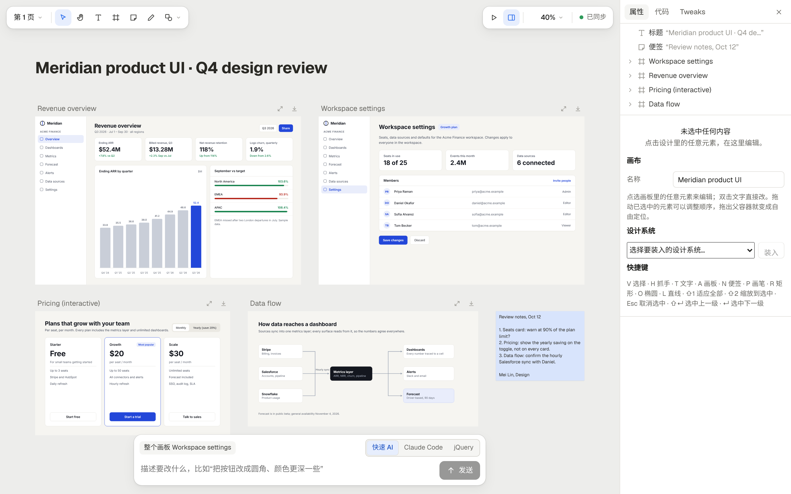

<p align="right"><b>English</b> · <a href="README.zh-CN.md">简体中文</a></p>

# Tingly Design

**An open-source design tool where people and AI edit the same files.**

Canvases, slide decks, design systems, dashboards and documents are plain files under `projects/`. You click, drag and retype on screen; a fast model rewrites what you point at in a few seconds, line by line; Claude Code edits the files directly. All three work on the same source, and every edit writes back only the characters that changed, so the files stay reviewable in git and pleasant to write by hand.



- **One source, three editors.** Direct manipulation (instant), fast AI (seconds; jQuery statements that run as they stream in) and Claude Code (minutes; whole files, several at once). Every open editor sees every change live, and all of them write to one shared change log.
- **Minimal write-back.** Template holes like `{{price}}`, loops and your own formatting survive every edit. Tick a checkbox or change a colour, and the git diff is one line.
- **Five project kinds.** The file formats follow Claude's Design, Slides, Design System, Dashboard and Docs artifact types; Tingly Design is an open-source re-creation of their two-way editing.
- **Numbers you can check.** Every figure on a dashboard names the cell it comes from, and anything that disagrees with its data is reported.

> The editor's interface is currently in Simplified Chinese. The sample projects, file formats and these docs are in English.

## Sample workspace

Five sample projects introduce our own two projects, **Tingly Design** (this repository) and [**Tingly Box**](https://github.com/tingly-dev/tingly-box), the open-source AI gateway that connects any agent to any model. They share the Tingly design system; usage figures in the dashboard and console mockups are demo data. Click a kind for its guide.

| Kind | Sample | What it shows | Files |
|---|---|---|---|
| [**Canvas**](docs/en/guide/canvas.md) | [`?p=box-console`](http://localhost:5173/?p=box-console) | A design review of the Tingly Box console: usage dashboard, team settings, an interactive "connect an agent" panel and the request-routing diagram | `canvas.json` + one `.dc.html` per artboard |
| [**Slides**](docs/en/guide/slides.md) | [`?p=tingly-intro`](http://localhost:5173/?p=tingly-intro) | "Meet Tingly": eight slides on Tingly Box and Tingly Design; the gateway slide carries a live animated diagram | `deck.json` + `slides/<id>.html` |
| [**Design system**](docs/en/guide/design-system.md) | [`?p=tingly-ds`](http://localhost:5173/?p=tingly-ds) | The Tingly brand: light and dark themes, Instrument Serif and Inter, a six-step type scale, four components and the marks | `design-system.json` + `tokens.json` + `components/` |
| [**Dashboard**](docs/en/guide/dashboard.md) | [`?p=box-usage`](http://localhost:5173/?p=box-usage) | A team's Tingly Box gateway usage for Q3 (demo data): two live SQLite queries, a CSV, a JSON file and a provider filter | `dash.json` + `datasets/` + `files/index.html` + `data/` |
| [**Docs**](docs/en/guide/docs.md) | [`?p=design-guide`](http://localhost:5173/?p=design-guide) | The Tingly Design handbook: four tabs, a project-kinds table, a setup checklist, a code block and comments | `doc.json` + `tabs/<id>.md` + `comments.json` |

A design system can be installed into a canvas or a deck; after that, colour fields and the text-style menu offer its tokens.

## Quick start

```bash
pnpm install
pnpm dev            # editor at http://localhost:5173, server on :8787
```

Open http://localhost:5173 to pick a project, or go straight to http://localhost:5173/?p=box-console for the sample canvas. For a production-style run, `pnpm start` builds the editor and serves it together with the API on port 8787.

### Configuration

| Variable | Purpose |
|---|---|
| `ANTHROPIC_API_KEY` | Turns on fast AI (the server calls the model through the Anthropic SDK). `ANTHROPIC_BASE_URL` and `ANTHROPIC_AUTH_TOKEN` work too. |
| `DC_FAST_MODEL` | The fast AI model; defaults to `claude-haiku-5-5`. |
| `DC_DELEGATE_MODEL` | The model for "hand to Claude Code" (the CLI's default when unset). |
| `DC_PROJECTS` | The projects folder; defaults to `projects/` in this repository. |
| `PORT` | The server port; defaults to 8787. |

- No API key is needed to start: jQuery mode lets you type statements yourself, through exactly the same execution and write-back path fast AI uses.
- "Hand to Claude Code" needs the `claude` command on this machine.

## Documentation

| | |
|---|---|
| **Guides** | [Canvas](docs/en/guide/canvas.md) · [Slides](docs/en/guide/slides.md) · [Design system](docs/en/guide/design-system.md) · [Dashboard](docs/en/guide/dashboard.md) · [Docs](docs/en/guide/docs.md) |
| **[Themes](docs/en/theming.md)** | Light, dark and Tingly Box's presets, and passing a theme in by URL, script, a host page or `DC_THEME` |
| **[How it works](docs/en/architecture.md)** | The source format, the write-back engine, fast AI, collaboration, sandboxing and the repository layout |
| **[Development and tests](docs/en/development.md)** | Unit tests, typecheck and the Playwright end-to-end suites |
| **[Compared with the original](docs/en/comparison.md)** | What matches Claude's artifact types and what is not there yet |
| **[From Design to five kinds](docs/zh/artifact-types.md)** | The design notes behind the five project kinds (in Chinese) |
