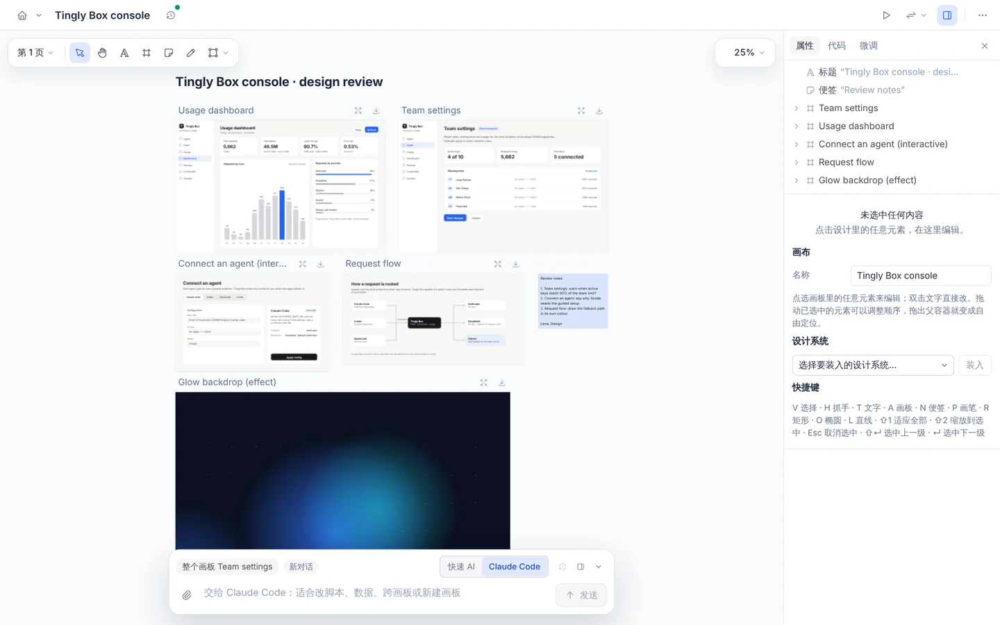
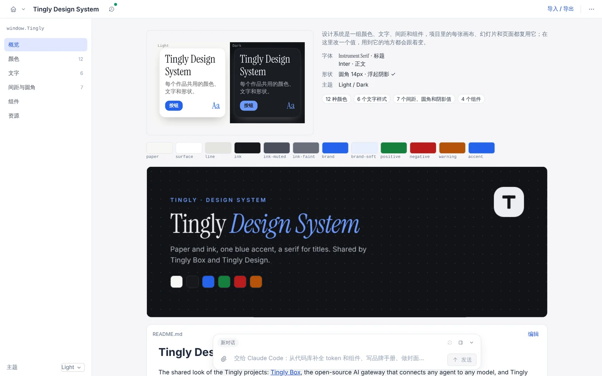
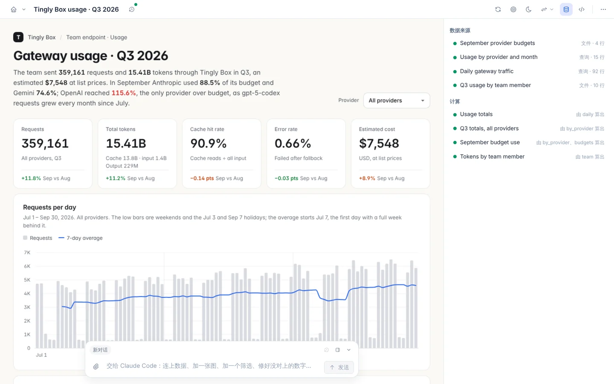
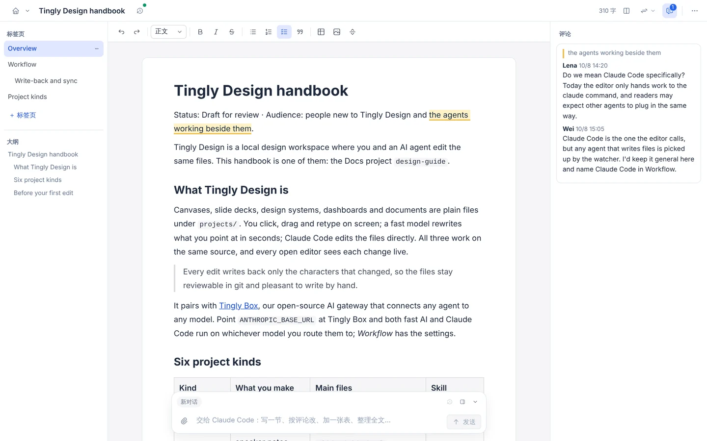

<p align="right"><a href="README.md">English</a> · <b>简体中文</b></p>

<p align="center">
  
</p>

<h3 align="center">人和 AI 改同一份文件的开源设计工具。</h3>

<p align="center">
  <a href="#快速开始">快速开始</a> ·
  <a href="#六种项目一个工作区">六种项目</a> ·
  <a href="#文档">文档</a> ·
  <a href="LICENSE">Apache-2.0</a>
</p>

<p align="center">
  
</p>

<p align="center"><sub>这段动画就是用 Tingly Design 做的：<a href="projects/design-motion"><code>projects/design-motion</code></a> 是一个动效项目，由应用自带的导出渲染。</sub></p>

## 一份设计，三种改法

画布、幻灯片、设计系统、数据看板、文档和动效，全部存成 `projects/` 下的普通文件。你在界面上点选、拖动、改字；快速 AI 在几秒内改出你指的地方；Claude Code 直接编辑文件。三方改的是同一份源码，每次只回写真正变了的那几个字符，所以这些文件可以放进 git、做 code review，也可以手写。

| | |
|---|---|
| **界面手改** | 点任意文字直接打字，拖动、缩放都在舞台上完成。秒回。 |
| **快速 AI** | 指着某处说想怎么改；逐行 jQuery，边写边显示。秒级。 |
| **Claude Code** | 改整份文件、跨文件，从提示栏或终端发起。分钟级。 |
| **最小补丁回写** | 模板里的 `{{占位}}`、循环和你的排版原样保留；勾一个待办、改一个颜色，git diff 只有一行。 |
| **数字可核对** | 看板上每个数字都标明来自哪份数据的哪一格，对不上就报出来。 |

## 六种项目，一个工作区

<p align="center">
  
</p>

其中五种文件格式沿用 Claude 的 Design / Slides / Design System / Dashboard / Docs 类型，Tingly Design 是其双向编辑机制的开源复刻；第六种“动效”是我们自己加的：按时间播放的场景，可导出视频。点图片看对应的使用指南。

<table>
<tr><td width="50%"><a href="docs/zh/guide/canvas.md"><picture><source media="(prefers-color-scheme: dark)" srcset="docs/images/readme/zh/canvas-dark.webp"></picture></a><br><sub><b>画布</b> · 界面、流程和组件并排放在一块画板上</sub></td><td width="50%"><a href="docs/zh/guide/slides.md"><picture><source media="(prefers-color-scheme: dark)" srcset="docs/images/readme/zh/slides-dark.webp"></picture></a><br><sub><b>幻灯片</b> · 全屏演示，可导出 PDF</sub></td></tr>
<tr><td width="50%"><a href="docs/zh/guide/design-system.md"><picture><source media="(prefers-color-scheme: dark)" srcset="docs/images/readme/zh/design-system-dark.webp"></picture></a><br><sub><b>设计系统</b> · 每个项目都能装入的 token 和组件</sub></td><td width="50%"><a href="docs/zh/guide/dashboard.md"><picture><source media="(prefers-color-scheme: dark)" srcset="docs/images/readme/zh/dashboard-dark.webp"></picture></a><br><sub><b>看板</b> · 实时图表，每个数字都能追到来源</sub></td></tr>
<tr><td width="50%"><a href="docs/zh/guide/docs.md"><picture><source media="(prefers-color-scheme: dark)" srcset="docs/images/readme/zh/docs-dark.webp"></picture></a><br><sub><b>文档</b> · 多人协作、带评论的纯 Markdown</sub></td><td width="50%"><a href="docs/zh/guide/motion.md"><picture><source media="(prefers-color-scheme: dark)" srcset="docs/images/readme/zh/motion-dark.webp"></picture></a><br><sub><b>动效</b> · 宣传片和动画，导出 MP4 或 GIF</sub></td></tr>
</table>

## 示例工作区

六个示例项目介绍的是我们自己的两个项目：**Tingly Design**（本仓库）和 [**Tingly Box**](https://github.com/tingly-dev/tingly-box)（开源 AI 网关，让任意 Agent 接任意模型）。它们共用 Tingly 设计系统；看板和控制台界面稿里的用量数字是演示数据。点类型名可以看对应的使用指南。

| 类型 | 示例 | 内容 | 文件 |
|---|---|---|---|
| [**画布**](docs/zh/guide/canvas.md) | [`?p=box-console`](http://localhost:5173/?p=box-console) | Tingly Box 控制台的设计评审：用量面板、团队设置、可交互的“接入 Agent”面板、请求路由图 | `canvas.json` + 每个画板一个 `.dc.html` |
| [**幻灯片**](docs/zh/guide/slides.md) | [`?p=tingly-intro`](http://localhost:5173/?p=tingly-intro) | “Meet Tingly”：8 页介绍 Tingly Box 和 Tingly Design，网关一页带实时动画图 | `deck.json` + `slides/<id>.html` |
| [**设计系统**](docs/zh/guide/design-system.md) | [`?p=tingly-ds`](http://localhost:5173/?p=tingly-ds) | Tingly 品牌：亮暗两套主题、Instrument Serif 和 Inter、六级字号、四个组件和标志 | `design-system.json` + `tokens.json` + `components/` |
| [**看板**](docs/zh/guide/dashboard.md) | [`?p=box-usage`](http://localhost:5173/?p=box-usage) | 一个团队三季度经 Tingly Box 网关的用量（演示数据）：两条 SQLite 实时查询、一份 CSV、一份 JSON、按服务商筛选 | `dash.json` + `datasets/` + `files/index.html` + `data/` |
| [**文档**](docs/zh/guide/docs.md) | [`?p=design-guide`](http://localhost:5173/?p=design-guide) | Tingly Design 使用手册：四个标签页、项目类型表、上手清单、代码块和评论 | `doc.json` + `tabs/<id>.md` + `comments.json` |
| [**动效**](docs/zh/guide/motion.md) | [`?p=design-motion`](http://localhost:5173/?p=design-motion) | 36 秒的 Tingly Design 宣传片：一个想法变成设计，人改一行字，AI 接着改，再逐一列出各种类型；同一套场景出 16:9 和 9:16，带独立封面 | `motion.json` + `scenes/<id>.html` |

设计系统可以装入画布或幻灯片，装入后颜色和文字样式菜单里就能直接选它的 token。

## 快速开始

```bash
pnpm install
pnpm dev            # 编辑器 http://localhost:5173 ，服务端 :8787
```

打开 http://localhost:5173 选一个项目，或直接打开 http://localhost:5173/?p=box-console 看示例画布。生产方式运行：`pnpm start`（先构建，再由服务端在 8787 端口同时提供 API 和编辑器）。

### 配置

| 环境变量 | 作用 |
|---|---|
| `ANTHROPIC_API_KEY` | 开启快速 AI（服务端用 Anthropic SDK 调模型）。也支持 `ANTHROPIC_BASE_URL`、`ANTHROPIC_AUTH_TOKEN`。 |
| `DC_FAST_MODEL` | 快速 AI 用的模型，默认 `claude-haiku-5-5`。 |
| `DC_LOG_LEVEL` | 服务端日志级别（输出到 stderr）：`error`、`warn`、`info`（默认）、`debug`、`silent`；见[开发](docs/zh/development.md#服务端日志)。 |
| `DC_DELEGATE_MODEL` | 交给 Claude Code 时用的模型（不设则用 CLI 默认）。 |
| `DC_PROJECTS` | 项目目录，默认仓库里的 `projects/`。 |
| `PORT` | 服务端端口，默认 8787。 |
| `DC_HOST` | 监听地址，默认 `127.0.0.1`；要让别的机器访问就设成 `0.0.0.0`。 |

- 没有 API key 也能用：右侧“代码”里的 jQuery 可以手写语句，走的是和快速 AI 完全相同的执行与回写链路。
- “交给 Claude Code” 需要本机能运行 `claude` 命令。

## 文档

| | |
|---|---|
| **使用指南** | [画布](docs/zh/guide/canvas.md) · [幻灯片](docs/zh/guide/slides.md) · [设计系统](docs/zh/guide/design-system.md) · [看板](docs/zh/guide/dashboard.md) · [文档](docs/zh/guide/docs.md) · [动效](docs/zh/guide/motion.md) |
| **[主题](docs/zh/theming.md)** | 浅色、深色和 Tingly Box 的预设主题，以及通过 URL、脚本、宿主页面或 `DC_THEME` 传入主题 |
| **[嵌入](docs/zh/embedding.md)** | 跑在 Tingly Box 等其他应用里：打包（`pnpm bundle`）、挂在路径前缀下启动、宿主和编辑器之间的消息 |
| **[工作原理](docs/zh/architecture.md)** | 源文件格式、回写引擎、快速 AI、协同、沙箱和项目结构 |
| **[开发与测试](docs/zh/development.md)** | 单元测试、类型检查和 Playwright 端到端测试 |
| **[与原版的差别](docs/zh/comparison.md)** | 哪些和 Claude 的 artifact 类型一致，哪些还没有 |
| **[设计说明](.design/README.md)** | 每个子系统为什么这样做，一个功能一份；以及每种项目类型都要支持的功能 |

## 许可证

[Apache License 2.0](LICENSE)。
