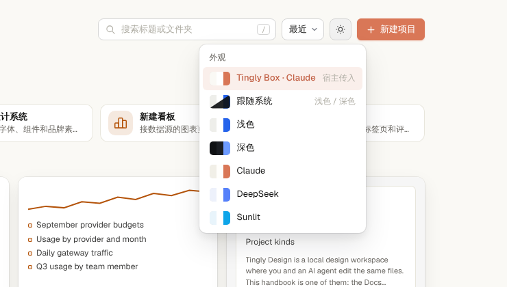

<p align="right"><b>English</b> · <a href="../zh/theming.md">简体中文</a></p>

# Themes

The editor's look is a set of named tokens (colours, shadows, fonts, radii) written as CSS custom properties on `<html>`. Pick one in the launcher's **Appearance** menu, or pass one in from outside. Themes change the editor around your work; canvases, slides, dashboards and design-system previews keep their own colours, since those are the files you are designing.



## Presets

The names match Tingly Box's theme modes, so a host can pass its own mode through unchanged.

| Name | Looks like |
|---|---|
| `system` | `light` or `dark`, following the operating system (the default) |
| `light` | Paper and ink with a blue accent; the light values of the Tingly Design System sample (`projects/tingly-ds`) |
| `dark` | The same system's dark values |
| `claude` | Anthropic's ivory and orange, as in Tingly Box's `claude` theme |
| `ds` | DeepSeek blue, as in Tingly Box's `ds` theme |
| `sunlit` | Sky blue, as in Tingly Box's `sunlit` theme |

## Passing a theme in

All four ways take the same value: a preset name, or an object.

```jsonc
{
  "base": "dark",          // a preset to start from; default: palette.mode, else light
  "name": "Rose",          // shown in the Appearance menu
  "tokens": { "accent": "#e11d48" },
  "palette": { ... }       // or Tingly Box's own palette (MUI shape), see below
}
```

| Where | How | Kept |
|---|---|---|
| URL | `?theme=dark` or `?theme=` + URL-encoded JSON | For the browser tab, across projects |
| Script | `window.tinglyDesign.setTheme(theme)`; also `getTheme()` and `presets()` | Until the page reloads |
| Host page | `iframe.contentWindow.postMessage({ type: 'tingly-design:set-theme', theme }, '*')` from the page embedding the editor, or the one that opened it | Until the page reloads |
| Server | `DC_THEME=claude pnpm dev`; also inline JSON or a path to a `.json` file | The default when the person has not picked one |

At start-up the URL wins over what the person picked in the menu, which wins over `DC_THEME`, which wins over `system`. After that the newest change wins. Picking in the menu is remembered and drops a theme the URL brought.

When embedded, the editor reports every change to its parent as `{ type: 'tingly-design:theme-changed', theme: { id, mode, scheme, name } }`.

### Tokens

`canvas` `panel` `panel-2` `hover` `line` `line-2` `ink` `ink-2` `muted` `faint` `accent` `accent-ink` `accent-soft` `on-accent` `danger` `danger-soft` `ok` `ok-soft` `warn` `warn-soft` `backdrop` `float-shadow` `lift-shadow` `ui` `mono` `r` `r-float`

Set only the ones you need. A token derived from one you set follows it unless you set it too: change `accent` and `accent-soft`, `accent-ink` and `on-accent` are worked out from it; change `panel` or `ink` and the lines, hover and grey text are mixed from them. Values that could load something (`url(`, `image(`) or end the declaration (`;`, `{`, `}`) are ignored.

### From Tingly Box

Tingly Box keeps its themes as MUI palettes. Pass one as `palette` and it maps like this:

| Palette | Token |
|---|---|
| `mode` | the base: `light` or `dark` |
| `primary.main` / `primary.dark` / `primary.contrastText` | `accent` / `accent-ink` (light mode) / `on-accent` |
| `background.default` / `background.paper` | `canvas` / `panel` (`transparent` is skipped) |
| `text.primary` / `text.secondary` / `text.disabled` | `ink` / `muted` / `faint` |
| `divider`, `action.hover` | `line`, `hover` |
| `error.main` / `success.main` / `warning.main` | `danger` / `ok` / `warn` |

```js
editorFrame.contentWindow.postMessage({ type: 'tingly-design:set-theme', theme: { name: 'Tingly Box', palette: theme.palette } }, '*');
```

---

Back to the [README](../../README.md)
