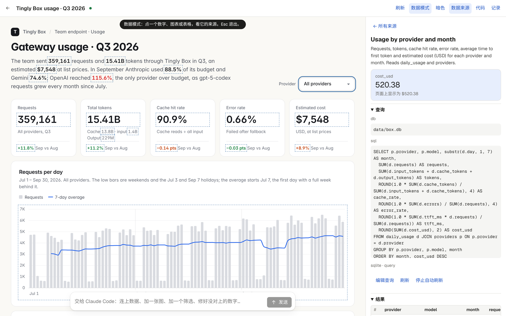

<p align="right"><a href="../../en/guide/dashboard.md">English</a> · <b>简体中文</b></p>

# 看板

示例 [`?p=box-usage`](http://localhost:5173/?p=box-usage) 是一个团队三季度经 Tingly Box 网关的用量看板（脚本生成的演示数据）：按服务商的请求、token、缓存命中率、费用、预算和成员用量；两个 SQLite 实时查询、一份 CSV、一份 JSON，四个计算，一个服务商筛选。



```
projects/<name>/
  dash.json               标题和筛选的默认值
  datasets/<id>.json      每份数据从哪来：data/ 下的文件，或一条实时查询（连接器 + 参数）
  files/index.html        页面：普通 HTML/CSS/脚本，用 dash API 和 d3 读数据画图
  data/                   CSV、TSV、JSON 文件和 SQLite 数据库
  .runs.json              打开的页面写下的报告：哪份数据没加载上、哪段代码报错、哪个数字和数据对不上（不进 git）
```

- **数据**：文件型数据直接读；查询型数据交给服务端的连接器运行（现在有 `sqlite`，只读打开 `data/` 下的数据库，见 `apps/server/src/connectors.ts`，可以照着加别的）。SQL 照原版的规则检查：只能是一条 SELECT / WITH，不能有写入类关键字；`{{name}}` 筛选参数绑定成一个字面量。
- **页面**：跑在 `sandbox="allow-scripts"`、禁网络的 iframe 里。`dash.data / onData / calc / loader / params / setParams / setLink / colors / refresh` 和原版一致，另有亮暗两套主题 token。
- **标注核对**：页面上每个带 `data-source` / `data-field` / `data-where` 的数字都会和它指向的单元格比对（认千分位、K/M/B 和万/亿、百分比、显示的精度），表格按 `data-row-key` 逐行核对；对不上的列在“数据来源 → 问题”里，也写进 `.runs.json` 给 Claude Code 看。数字的加载、刷新、失败、空值状态会标在元素上，页面可以用 CSS 画出来。
- **数据来源面板**：每份数据的状态、行数、更新时间、“未使用”；点开看说明、查询（`{{参数}}` 显示当前值）、结果表、计算的公式；可以改查询、试运行、保存，下载 CSV，把查询“停止自动刷新”（结果存成 `data/<id>.json`）再恢复。
- **导入 / 导出**：顶栏的“导入 / 导出”可以导入数据（CSV、TSV、JSON），也把整个页面按现在的样子（主题、筛选和已加载的数据都在）存成 PNG。同一个菜单最后的“整个项目（.zip）”存的是项目本身：所有文件和改动记录；“仅项目文件（.zip）”不带改动记录。在首页“新建”菜单里选“导入项目（.zip）…”就能重新打开（重名时加 `-2`），自己把项目文件夹压成的 zip 也行。
- **数据模式**：点页面上的数字、图表或表格单元格，右侧打开它的来源并高亮那一格。
- **代码**：页面和数据说明也能直接在编辑器里改（原版只允许 Claude 写）；改完页面立即重载。
- **AI**：交给 Claude Code。它可以用 `node scripts/dash-query.mjs` 只读地查数据库，会先读 `.runs.json`。查询来的数据保持为实时查询，不复制成文件；编出来的示例数据标题以 “Sample” 开头；改完后（看板开着时）再读一遍页面的报告；最后说明每个数字来自哪里。
- **导入数据**：顶栏的"导入"，或把 CSV、TSV、JSON 表格拖进来。每个文件变成一个数据集，文件存进 `data/`，在"数据来源"里打开；读不出表格的文件会直接说明原因。

格式说明：[`.claude/skills/dashboard/SKILL.md`](../../../.claude/skills/dashboard/SKILL.md)

---

返回 [README](../../../README.zh-CN.md)
