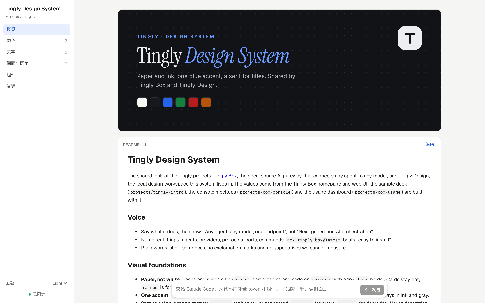
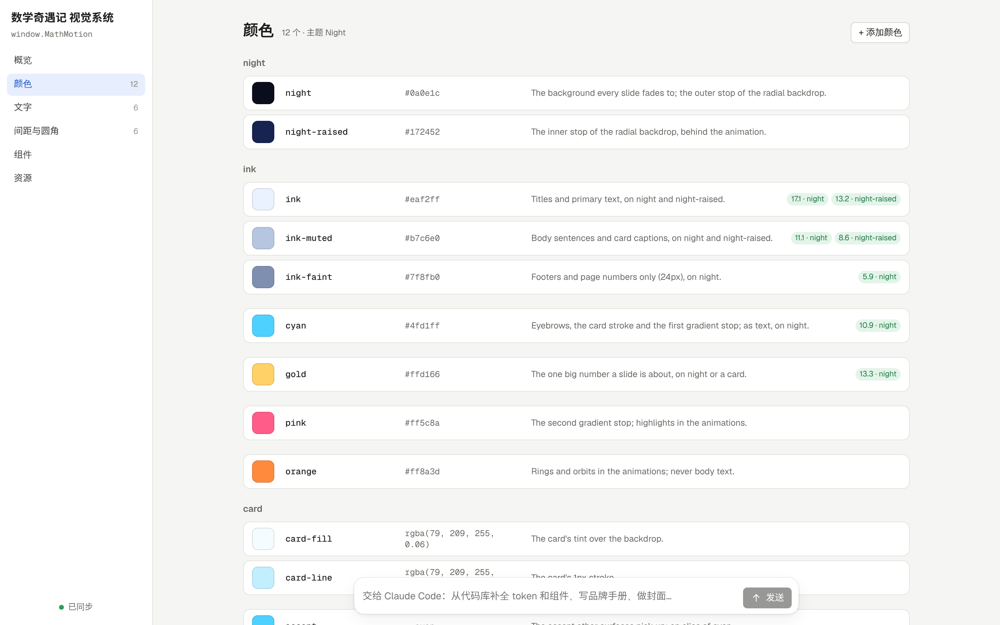

<p align="right"><a href="../../en/guide/design-system.md">English</a> · <b>简体中文</b></p>

# 设计系统

示例 [`?p=tingly-ds`](http://localhost:5173/?p=tingly-ds) 是 Tingly 设计系统：控制台界面稿、幻灯片和看板共用的颜色（亮暗两套）、字体、字号、间距和组件，取自 Tingly Box 官网和控制台。

| 概览：封面 + 品牌手册 | 颜色：用法与对比度 |
|---|---|
|  |  |

```
projects/<name>/
  design-system.json      索引：标题、namespace、资源分组
  tokens.json             颜色（按主题）、文字、间距、圆角、阴影……都是 {name, value, usage} 列表
  tokens.css              由 tokens.json 自动生成（编辑器、Claude Code、终端改 tokens.json 都会重新生成）
  README.md、*.md          品牌手册
  components/<C>/         README.md（使用说明）和 preview.html（实时预览）；Cover 是封面
  components/bundle.js    组件实现，挂在 window.<namespace>；bundle.css、index.d.ts
  assets/<分组>/、fonts/   标志、图标、图片和字体文件
```

- **页面**：概览（顶部是这套系统的样张、字体、形状、主题和数量，再往下是完整色板、封面和品牌手册，可直接编辑 Markdown；启动页的卡片画封面，带上组件样式；没有封面时画同一张样张，两套系统的差别一眼可见）、颜色（按主题切换；用法里写“on surface”就显示在那个底色上的对比度；别名显示指向谁）、文字（每个样式按自己的字体和字号渲染）、间距与圆角与阴影、组件（每个预览都在沙箱里先加载 tokens.css、bundle.css、bundle.js 再运行）、资源（按分组上传、下载、删除）。
- **导入 / 导出**：左栏底部的“导入 / 导出”按钮可以导入字体和图片，也把当前页面（概览、颜色、字体……）存成 PNG，或复制到剪贴板（“复制为 PNG”）。组件预览在各自的框架里运行，图片里是空白。同一个菜单最后的“整个项目（.zip）”存的是项目本身：所有文件和改动记录；“仅项目文件（.zip）”不带改动记录。在首页“新建”菜单里选“导入项目包（.zip）…”就能重新打开（重名时加 `-2`），自己把项目文件夹压成的 zip 也行。
- **原地改 token**：点一行展开，改值、改名（别名会跟着改）、写用法、增删。保存的是 tokens.json 的数据，tokens.css 随之重建，只改真正变了的那几行。
- **阴影**写成 CSS 的 box-shadow。阴影里可以用 `var(--accent)` 引用这套系统自己的颜色，这样它随主题变；别的 `var()` 不读。
- **检查**：tokens.json 里不符合原版语法的部分（颜色里的名字和 `var()`、不存在的别名、循环别名、DTCG 的 map 写法……）会被丢弃并在“问题”里写明原因。
- **装进画布或幻灯片**：在画布或幻灯片的面板里（不选中任何东西时）选择“设计系统 → 装入”。tokens.json 复制到那个项目的 `ds/<folder>/`，索引的 `designSystems` 记一条；之后所有颜色输入框旁边有 ◆ 可以选它的颜色、并标出当前值是哪个 token，文字样式菜单列出它的样式；幻灯片还会拿到它的字体。幻灯片里写的是颜色值本身（子集不允许 `var()`）。
- **一键换主题**：装入设计系统之后，画布和幻灯片右侧面板的“主题”页签里，每个已装入系统的每个主题是一张卡，最前面还有“原样”。点一下，整个画布的每块画板（幻灯片是所有页，或只改当前这一页：会问“应用到”）里代表页面、卡片、文字、线条和强调色的颜色就换成所选主题的，幻灯片连字体一起换。文件里写的是普通颜色值，不是变量。换完的提示条带“撤销”（⌘Z 也一次全退）；“原样”会换回第一次切换时被替换掉的颜色。卡片下面写着作品现在穿的是哪个主题、有几种颜色不属于任何设计系统所以没动（并提议让 Claude 去换），再往下是这个主题的颜色（按角色分组）和文字放在底色上的对比度。
- **怎么用它（README 的最后一节）**：`README.md` 末尾是自动生成的“Consuming this system”一节，写给用这套系统做东西的人（包括 Claude Code）：要链接哪个样式表、放在哪，主题和 `data-theme`，每个颜色的变量和备用值，色阶（`gray-100`、`gray-500`……）合成一行，交互状态单列，字体族和变量，文字样式的斜体与字距，再到间距、圆角和阴影。`tokens.json` 一变，页面就连同 `tokens.css` 重写这一节，所以品牌手册写在它上面，别动它。画布的画板和幻灯片不能链接样式表，这一节会告诉对方直接用表里的值。
- **字体文件**：`woff2`、`woff`、`ttf`、`otf`、`ttc`。`.ttc` 字体集合像其他字体一样登记、保留为文件，但浏览器不会通过 `@font-face` 加载集合，页面要显示它就换成同一字体的 woff2。
- **托管字体**：`tokens.json` 的 `type.hosted: [{family, href}]` 是这里的扩展（原版只认字体文件），用 Google Fonts 的 css2 链接；预览和装入的幻灯片都会加载。
- **AI**：原版设计系统页面没有页内模型，这里也只交给 Claude Code。
- **导入**：左栏底部的导入按钮，或把文件拖进来。字体文件加进字体（写进 `tokens.json`），图片和 SVG 加进素材的 Other 分组。

格式说明：[`.claude/skills/design-system/SKILL.md`](../../../.claude/skills/design-system/SKILL.md)

---

返回 [README](../../../README.zh-CN.md)

## 从一个风格开始

新建设计系统可以从空白开始，也可以从 36 个风格里选一个，按感觉分成五组：干净明亮、编辑出版、大胆活泼、科技感、编辑器配色。在新建对话框里选“设计系统”，再选一组、一个风格（每个都用它自己的页面色、文字色、强调色和字体画出来）。命令行：

```bash
tingly-design new design-system acme --look swiss-grid
```

风格决定颜色（一套主题）、字体族、圆角和阴影；文字样式和间距是通用的，README 里写明风格的来源（html-ppt 模板的主题，MIT 许可）。它还带着这个风格的组件（Title、Kicker、Card、Pill、Divider，用原主题自己的描边、阴影和渐变画）和一张同样风格的封面，打开概览一眼就能看出是什么风格。它只是起点，不是链接：建好之后这套系统由你自己改。

模板名称在中文界面中也保留原始英文。新建画布或幻灯片时，在设计系统字段下展开“内置”，按风格分组选择模板；编辑器的设计系统面板也有相同入口，即使还没有设计系统项目也能使用。选择后分组自动收起，字段显示所选模板名。模板的 token 直接复制到当前项目，不会额外创建设计系统项目。只差一张起始封面的幻灯片项目会立刻带上风格的颜色：封面按风格的页面色、文字色和标题字体重画一遍，选了什么第一眼看到的就是什么；已经设计过的 deck 一页都不会动。
