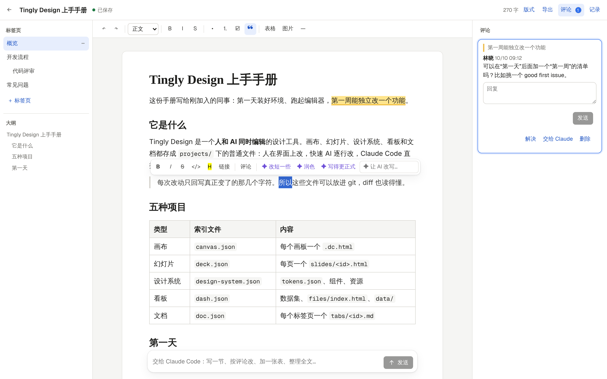

<p align="right"><a href="../../en/guide/docs.md">English</a> · <b>简体中文</b></p>

# 文档

示例 [`?p=design-guide`](http://localhost:5173/?p=design-guide) 是 Tingly Design 使用手册：四个标签页（一个子页）、项目类型表、上手清单、引用、代码块和两条评论。



```
projects/<name>/
  doc.json          标题、标签页（顺序、子页）、版式设置
  tabs/<id>.md      每个标签页一个 Markdown 文件（GFM：表格、待办）
  comments.json     评论讨论，按引用的文字定位
  assets/           上传的图片
```

- **富文本编辑**：TipTap 编辑器，工具条、选中文字后的格式菜单、在空行输入 `/` 插入标题/列表/待办/引用/代码/表格/分割线/图片/日期；左侧标签页（新建、子页、改名、排序、删除）和大纲。
- **按块回写**：编辑器给出整页 Markdown，`packages/core/src/docs.ts` 的 `mergeBlocks` 把它合回文件：意思没变的块原样保留，变了的块里没变的行（列表项、表格行）也原样保留。勾一个待办、改一个单元格，git diff 都只有一行。同时被别人（或 Claude Code）改了的文件，按块重放你的改动；外面改的内容实时出现在打开的标签页里，光标不丢。
- **评论**：选中文字点“评论”，讨论按引用的文字（加前后文）定位，文字还在就高亮；回复、解决、删除；“交给 Claude”让 Claude Code 读这条讨论、按它改文档并在讨论里回复。
- **AI 改写**：选中内容后“改短一些 / 润色 / 写得更正式”或自己写要求，模型流式给出新的段落，替换或插到下方（需要 `ANTHROPIC_API_KEY`）。整篇的事交给 Claude Code。
- **版式、导入与导出**：标题、正文字体（衬线 / 无衬线）、版面宽度；“导入 / 导出”菜单可以导入 Markdown，一键把整个文档存成 PDF（A4，由运行服务端那台机器上的 Chrome 生成；没有 Chrome 时打开打印窗口），把当前标签页或整个文档存成 Markdown，整个文档存成 HTML，当前标签页存成 PNG 图片。
- **导入**：顶栏的"导入"，或把 Markdown 文件（连同它的文件夹）拖进来。每个文件变成一个新标签页，标题取它的第一个标题；它引用的图片和原文件留在 `uploads/`。

格式说明：[`.claude/skills/docs/SKILL.md`](../../../.claude/skills/docs/SKILL.md)

---

返回 [README](../../../README.zh-CN.md)
