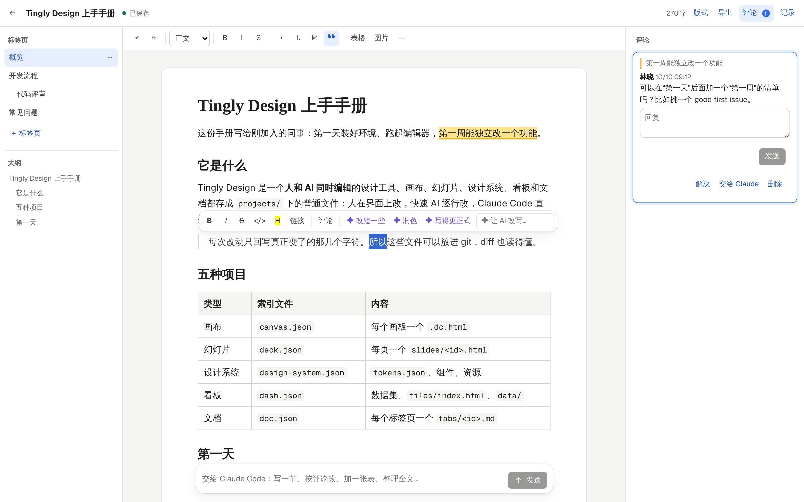

<p align="right"><a href="../../en/guide/docs.md">English</a> · <b>简体中文</b></p>

# 文档

示例 [`?p=tingly-design-guide-doc`](http://localhost:5173/?p=tingly-design-guide-doc) 是 Tingly Design 使用手册：四个标签页（一个子页）、项目类型表、上手清单、引用、代码块和两条评论。



```
projects/<name>/
  doc.json          标题、标签页（顺序、子页）、版式设置
  tabs/<id>.md      每个标签页一个 Markdown 文件（GFM：表格、待办）
  comments.json     评论讨论，按引用的文字定位
  assets/           上传的图片
```

- **富文本编辑**：TipTap 编辑器，工具条、选中文字后的格式菜单、在空行输入 `/` 插入标题/列表/待办/引用/代码/表格/分割线/图片/日期；左侧标签页（新建、子页、改名、排序、删除）和大纲。链接用 ⌘/Ctrl 加点击打开，或用选中菜单里的打开按钮。选中菜单还能给文字上色（红、橙、绿、蓝、紫、灰；存的是颜色的名字，画出来的颜色在浅色和深色下都看得清；文件里是 `<span data-color="red">文字</span>`，导出 Markdown 时文字还在，导出 HTML、PDF、PNG 时颜色也带着）。
- **按块回写**：编辑器给出整页 Markdown，`packages/core/src/docs.ts` 的 `mergeBlocks` 把它合回文件：意思没变的块原样保留，变了的块里没变的行（列表项、表格行）也原样保留。勾一个待办、改一个单元格，git diff 都只有一行。同时被别人（或 Claude Code）改了的文件，按块重放你的改动；外面改的内容实时出现在打开的标签页里，光标不丢。
- **会自己画的代码块**：标成 `mermaid` 的围栏画成图，`latex` 画成公式，`csv` / `tsv` 画成表格（`/diagram`、`/formula` 可插入）。点一下看到并编辑源码；画不出来时说明原因并保留文字。文件里始终是普通围栏。
- **Claude Code 看到你看到的**：底部输入框会告诉它当前标签页、光标所在的章节和段落、选中的文字和打开的评论讨论，所以“把这段改短”不用再粘贴。
- **谁在改哪里**：Claude Code、编辑器外的程序或另一个编辑器窗口改了打开着的标签页时，改到的第一段或第一块外面出现一圈它的颜色的框和它的名字，它改到下一处时跟过去，停下几秒后淡出。它不挡点击；你自己打字不出框。
- **表格导出 CSV**：光标在表格里时，工具条的 CSV 按钮把它下载为 `.csv`（首行作列名）。反过来，```csv 围栏会画成表格。比页面宽的表格在原地横向滚动。
- **历史版本**：一次编辑覆盖标签页之前，被覆盖的文本会留下（一分钟最多一份，留最近 40 份，只在本机，不进 zip 和提交）。顶栏的“历史版本”列出它们，点一份可以先读原文，或切到“改动”看它与当前文本的块级差异（只有这一版有的块、只有现在有的块），“恢复这个版本”把它当作一次普通编辑写回，被它盖掉的文本会先留一份。
- **评论**：选中文字点“评论”，讨论按引用的文字（加前后文）定位，文字还在就高亮；回复、解决、删除；给某条评论加表情回应（👍 ✅ ❤️ 🎉 😄 👀，再点一次收回自己的）；“交给 Claude”让 Claude Code 读这条讨论、按它改文档并在讨论里回复。
- **AI 改写**：选中内容后“改短一些 / 润色 / 写得更正式”或自己写要求，模型流式给出新的段落，替换或插到下方（需要 `ANTHROPIC_API_KEY`）。整篇的事交给 Claude Code。
- **主题**：顶栏的“主题”给整份文档穿上一套设计系统：颜色、字体和圆角，编辑器里和每种导出（HTML、PDF、PNG、微信公众号文章）都一样。在那里装入一套（项目里的设计系统，或“发布平台”下内置的“WeChat”等风格；装入就穿上），再点卡片换主题，点“文档自己的样子”回去。文字仍是普通的 Markdown：`doc.json` 只记着文档穿的是哪套系统的哪个主题。Word 暂时不跟。系统可以用自己的 `doc-*` token 说文档怎么排（引用、代码、表头的颜色，标题和正文的字号，栏宽、段距、列表缩进）；没说的由它的其他颜色推出来。它还可以在 `tokens.json` 里用 `doc` 一族的 CSS 声明给元素加装饰（每个一级标题旁一道色条、图片外一圈边框），页面和每种导出画得一样。
- **版式、导入与导出**：标题、正文字体（衬线 / 无衬线）、版面宽度；“导入 / 导出”菜单可以导入 Markdown，一键把整个文档存成 PDF（A4，由运行服务端那台机器上的 Chrome 生成；没有 Chrome 时打开打印窗口），把当前标签页或整个文档存成 Markdown（文档标题和标签页按顺序成为各级标题，`==高亮==` 写成 `<mark>`，评论不导出；有本地图片时是一个 `.zip`，里面是 .md 和它旁边的图片），整个文档存成 Word 文件（.docx：标题、列表、表格、引用、代码、链接和图片都在；Google 文档从 Drive 里打开它）、“复制为 Markdown（当前标签页）”贴进 Notion、GitHub 或聊天、“微信公众号…”（整个文档，或“当前标签页”）发到公众号：先看预览（上面是一路上改了什么，下面是公众号正文栏宽度的文章；就是编辑器里文档的样子、什么也不加；要按公众号自己的样子发，就让文档穿上内置的“WeChat”设计系统，或在预览里点“用微信的样子”）（指向其他网站的链接改成文末的编号列表，图片压到编辑器收得下的大小，Mermaid 和公式块画成图片），再点“复制”，到 mp.weixin.qq.com 的文章编辑器里粘贴（或“保存为 HTML”，在页面里复制；命令行 `export --as wechat` 做的就是这个页面）、整个文档存成 HTML，当前标签页存成 PNG 图片，或用“复制为 PNG”把它作为图片放进剪贴板。同一个菜单最后的“整个项目（.zip）”存的是项目本身：所有文件和改动记录；“仅项目文件（.zip）”不带改动记录。在首页“新建”菜单里选“导入项目包（.zip）…”就能重新打开（重名时加 `-2`），自己把项目文件夹压成的 zip 也行。
- **导入**：顶栏的"导入"，或把 Markdown 文件（连同它的文件夹，或导出文档得到的 `.zip`）拖进来。每个文件变成一个新标签页，标题取它的第一个标题；它引用的图片和原文件留在 `uploads/`。 单独的图片（GIF 保持动画）放到当前标签页末尾；粘贴或拖进正文，则落在光标处或落点。

格式说明：[`.claude/skills/docs/SKILL.md`](../../../.claude/skills/docs/SKILL.md)

---

返回 [README](../../../README.zh-CN.md)
