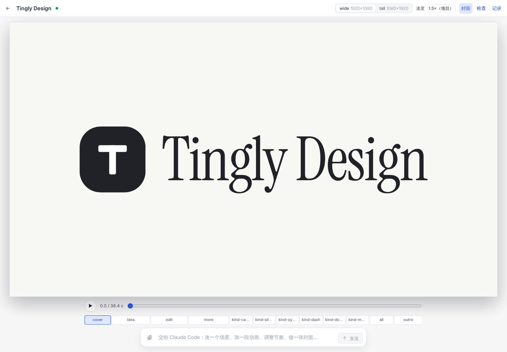

<p align="right"><a href="../../en/guide/motion.md">English</a> · <b>简体中文</b></p>

# 动效

新建项目时类型选“动效”，然后选尺寸：横版 16:9（B 站、YouTube、X/Twitter、PPT）、竖版 9:16（抖音、视频号、快手、TikTok、Reels）、方形 1:1、竖图 4:5 或 3:4（Instagram、小红书）、经典 4:3（旧版 PPT），或任意宽高。下一个作品默认用上次的尺寸，自己用过的尺寸会和预设放在一起。示例 [`?p=design-motion`](http://localhost:5173/?p=design-motion) 是 36 秒的 Tingly Design 宣传片，同一套场景出 16:9 和 9:16，带独立封面。



```
projects/<name>/
  motion.json          标题、尺寸 formats、帧率 fps、速度 speed、场景顺序 order、封面 cover
  scenes/<id>.html     每个场景一个文件：正好一个 <section id="<id>">，和幻灯片相同的封闭子集
  renders/             导出的视频（不进 git）
```

- **舞台和播放器**：暂停时，舞台显示播放头所在的场景在这一刻的样子，可以像幻灯片一样直接改。空格播放：播放器接过去，连同转场播完整条时间线；暂停后舞台回来，停在刚才的位置。← / → 逐帧，按住 Shift 每次一秒。舞台下的刻度尺和场景条共用一条时间轴：每个场景块从场景开始的时刻起，到下一个场景接手为止，播放头竖穿两行。在刻度尺上点或拖可以定位，点一个场景就跳到它的开头，双击跳到它的结尾。要改一个场景的时长：拖它的色块右沿（0.1 秒一档，Esc 取消），或在时间轴上方的时长框里直接输入，或在属性面板里改。停在场景开头时，舞台把所有元素按落定的样子画出来，整个场景像一页幻灯片一样可以直接改（时间轴下的标签会写“落定”）；往后走一帧就是真实画面。封面是可选的，放在 0 秒之前，在时间轴最左边单独的一格：点它可以编辑封面（视频缩略图和导出文件的第一帧就是它），点“+ 封面”新建一个，点 × 取消封面、改用第一帧。有封面时，打开项目停在封面。
- **批注**：顶栏的"批注"展开两个框：整个作品的批注（`motion.json` 的 `note`）和舞台上这个场景的批注（场景文件末尾的 `<aside>`，和幻灯片的演讲者备注是同一种写法）。写给谁看、什么调子、这个场景要讲什么；批注不会画进画面，也不会渲染，你向 Claude 提要求时它会读到。有批注的场景块上有一个小点。
- **在舞台上改**：单击选中，双击改字，拖手柄改尺寸（Shift 保持比例，Alt 从中心缩放，边缘会吸附到其他元素）。右侧面板：选中元素时是它的样式；选中场景时是场景时长、转场和背景；什么都没选时是作品的尺寸。播放头这一刻不在画面上的元素点不到，可以从图层里选，图层会标出它们何时入场，每行同样有隐藏和锁定（隐藏的元素播放器和渲染里也不出现）。选中的元素显示它落定的位置，而不是入场到一半。撤销和其他类型一样。
- **尺寸**：`motion.json` 里的每种尺寸都用同一套场景播放，在顶栏切换，在面板里添加、改尺寸或删除（横版 16:9、竖版 9:16、方形、竖图 4:5，或自定义）。看着第一种尺寸时的改动对所有尺寸生效；在别的尺寸里改，会写成这个尺寸的覆盖（`data-tall="…"`），面板会写明改到哪里。点覆盖标签可以退回共用的值。
- **导入图片**：把图片或 SVG 拖进来、粘贴，或用顶栏的导入按钮，放到播放头所在的场景上，从播放头这一刻淡入（停在场景开头时从 0 开始），原文件存进 `uploads/`。
- **从项目导入**："导入 / 导出"菜单里的"从项目导入…"列出各个画布的画板。选中的画板复制进这个动效（`uploads/<画布>-<画板>/`），放到播放头所在的场景。会随时间变化的画板（特效）铺满画面、放在最底层，按场景时间逐帧绘制，舞台、播放器和渲染出的视频都一样；静止的画板从播放头淡入。选中它可以改参数、打开原画板，或从原画板更新。
- **速度**：时间按阅读节奏来写，`motion.json` 的 `speed` 决定视频播多快。速度菜单可以试别的节奏，不改任何文件。
- **检查**：列出时间上的问题，比如退场早于入场、文字停留不到 0.8 秒、导不出的嵌入。
- **AI**：底部输入框针对播放头所在的场景，或选中的元素。小改动选快速 AI，马上落在舞台上；大改动选 Claude Code，它会知道你看的是哪个场景、哪一刻、哪种尺寸。
- **保存当前帧**：“保存当前帧为图片”把播放头所在的画面按当前尺寸存成 PNG。
- **导出**：“导入 / 导出” → “视频…”打开一个对话框，只有一行摘要（“MP4 · 1920×1080 · 30 帧/秒 · 整段”）和“导出”按钮，多数时候点一下就够了。“更多选项”展开后可选格式（MP4，浏览器写不了 H.264 时用 WebM；WebM；GIF）、尺寸（作品自己的，或更小的常见高度）、帧率、质量、范围（整段，或只导出播放头所在的场景，不带声音）。每个视频文件都带一条音轨，没有声音的作品写一条静音轨，因为有的平台拒收没有音轨的文件。GIF 也可以直接点菜单里的“GIF…”，默认小尺寸、15 帧/秒。视频在这个标签页里生成，不用装任何东西：浏览器能写 H.264 和 AAC 时（Chrome、Edge、Safari）存 MP4，否则存 WebM，提示会说是哪种、为什么。完成前请让标签页留在前台；栏里会出现进度和取消按钮。字体和音频文件会一起带上。含嵌入内容（`<x-embed>`）或视频层的作品改由运行服务端那台机器上的 Chrome 或 Edge 来画（还需要 ffmpeg），对话框里会说明；这条路线同样可选尺寸、帧率、范围，格式只有 MP4 和 GIF（没有 WebM）。机器上两样都没有时，视频仍在这个标签页里生成：每个嵌入内容逐帧交出自己的画面（稍慢一些）；没交出画面的场景会在提示里点名，视频层在这条路线上不逐帧对齐。同一个菜单里的“PNG 图片”存播放头所在的那一帧。封面 PNG 和单文件播放器用命令行：`pnpm --filter @dc/sandbox build && node scripts/motion-render.mjs <name> [--format wide] [--gif] [--player]` 把 MP4、封面 PNG、GIF 和单文件 HTML 播放器写进 `renders/`，命令行需要 Chromium 和 ffmpeg。

时间写在元素上：`<section>` 上的 `data-duration`、`data-transition`，以及里面任意元素的 `data-in` / `data-out` 预设（`rise`、`drop`、`type`、`count`…）和 `data-keys` 关键帧。

格式说明：[`.claude/skills/motion/SKILL.md`](../../../.claude/skills/motion/SKILL.md) · 设计方案：[`.design/motion.md`](../../../.design/motion.md)

---

返回 [README](../../../README.zh-CN.md)
