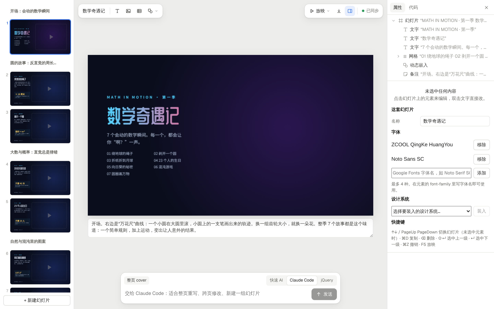

<p align="right"><a href="../../en/guide/slides.md">English</a> · <b>简体中文</b></p>

# 幻灯片

新建项目时类型选“幻灯片”。示例 [`?p=tingly-intro`](http://localhost:5173/?p=tingly-intro) 是“Meet Tingly”，介绍 Tingly Box 和 Tingly Design；网关一页右侧是一段 `<x-embed>` 实时动画图。



```
projects/<name>/
  deck.json            标题、顺序 order、分节 sections、字体 faces
  slides/<id>.html     每页一个文件：正好一个 <section id="<id>">，1920×1080，封闭的 HTML/CSS 子集
  assets/              上传的图片和字体
```

- **左侧缩略图条**：按节分组（双击节名改说明）；拖动排序；右键新建、复制、跳过、从这一页开始新的一节、删除。缩略图里的动态嵌入不运行，只显示占位。
- **舞台**：当前页按比例缩放；选中、双击改字、拖动重排或拖出成自由定位、右侧面板（图层/属性/代码）和画布完全一样，走同一个最小补丁回写。下方是演讲者备注（写进 `<aside>`）。
- **插入**：文字、图片（上传到 `assets/`）、表格、形状（矩形、圆角、椭圆、菱形、四向箭头、直线）、连线、图标。
- **格式检查**：每一页都按原版 `format.md` 的子集检查（不认识的标签、`margin`、`z-index`、`em`、`var()`、`<x-embed>` 没有钉住……），舞台上方和缩略图上标出处数，点一条就选中对应元素。快速 AI 改完如果引入了新的越界，会被撤销并把原因告诉模型重写。
- **放映**：F5 从头、⇧F5 从当前页；→ / 空格 / 点击 先播放这一页的出场动画（`data-build-in`），再翻页；切换效果 `fade` / `push`（`magic` 先按淡入淡出处理）；N 打开演讲者备注栏；F 全屏；Esc 退出。
- **下载**：单个 HTML 文件（图片内联、嵌入在沙箱里照常运行、方向键翻页）、打印成 PDF、演讲者备注文本。

渲染上忠实于原版的几处规则：没写 `display` 的 `<div>` 是纵向 flex；子元素按源码顺序绘制，所有流式内容作为一层画在第一个流式子元素的位置（所以写在最前面的全幅背景会在文字下面）；`<x-embed>` 跑在独立的沙箱页里（无网络、不同源）。

格式说明：[`.claude/skills/slides/SKILL.md`](../../../.claude/skills/slides/SKILL.md)

---

返回 [README](../../../README.zh-CN.md)
