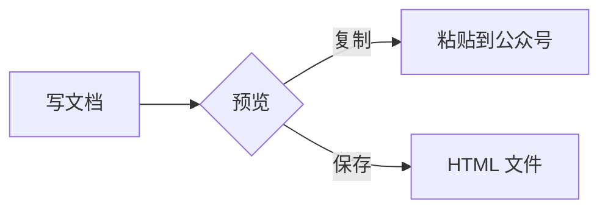

# 一级标题 Heading 1

正文段落，包含 **粗体**、*斜体*、~~删除线~~、`行内代码`、==高亮== 和 <mark>标记</mark>，以及<span data-color="red">红</span><span data-color="orange">橙</span><span data-color="green">绿</span><span data-color="blue">蓝</span><span data-color="purple">紫</span><span data-color="gray">灰</span>六种文字颜色。这一行很长是为了看自动换行：The quick brown fox jumps over the lazy dog, 然后继续写一些中文让一行铺满手机屏幕的宽度，看看行距和字距是否舒服。

第二段，行尾带强制换行  
换行之后的文字。

## 二级标题 Heading 2

### 三级标题 Heading 3

#### 四级标题 Heading 4

##### 五级标题 Heading 5

###### 六级标题 Heading 6

## 引用

> 这是一段引用文字，用于验证 blockquote 的渲染，它可以写得很长很长很长很长很长很长很长很长很长，直到折行。
>
> 引用里的第二段，带 **粗体** 和 [链接](https://example.com/in-quote)。
>
> > 嵌套的引用。

## 列表

- 无序列表项一
- 无序列表项二
  - 嵌套列表项 2.1
  - 嵌套列表项 2.2
    - 再嵌套一层 2.2.1
- 无序列表项三，带 **粗体** 和 `代码`

1. 有序列表项一
2. 有序列表项二
   1. 嵌套有序 2.1
   2. 嵌套有序 2.2
3. 有序列表项三

- [x] 已完成的待办
- [ ] 没完成的待办

3. 从 3 开始的有序列表
4. 第二项

## 链接

- 外部链接会变成文末编号引用：[Tingly Design](https://github.com/tingly-dev/tingly-design)
- 同一个地址再出现一次，用同一个号：[仓库](https://github.com/tingly-dev/tingly-design)
- 另一个外部链接：[Example](https://example.com/a?b=1&c=2)
- 公众号文章链接保持可点：[一篇文章](https://mp.weixin.qq.com/s/abcdef)
- 地址本身就是文字，不再另列：<https://example.org/plain>
- 邮件：[写信](mailto:hi@example.com)

---

## 表格

| 左对齐 | 居中 | 右对齐 |
| :--- | :---: | ---: |
| 内容 A | 内容 B | 1 |
| **粗体** | `代码` | 22 |
| 很长很长很长很长很长很长很长很长的一格 | 短 | 333 |

## 代码

```ts
function hello(name: string): string {
  // 缩进与空行
  const greeting = `Hello, ${name}!`;

  return greeting < "z" ? greeting : "";
}
```

```
没有语言的代码块
  保留缩进
```

## 图片


## 会自己画的块



```latex
E = mc^2 \qquad \int_0^1 x^2\,dx = \frac{1}{3}
```

```csv
名称,数量,备注
苹果,3,红
香蕉,12,黄
```

## 其他

<div>原始 HTML 块会被略去并提示。</div>

最后一段。
